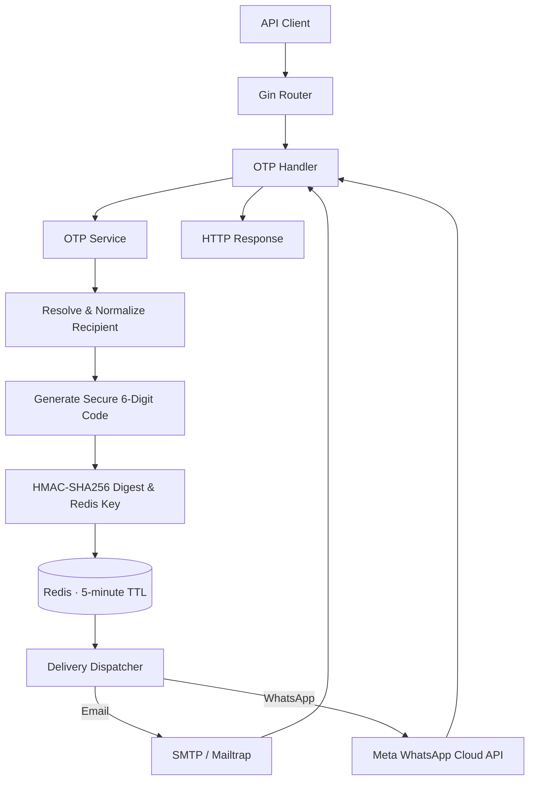

# OTP Service

**A modular one-time password (OTP) delivery API built with Go, Gin, and Redis.**

[](https://go.dev/)
[](https://gin-gonic.com/)
[](https://redis.io/)


OTP Service provides a single endpoint for requesting six-digit verification codes through **email** or **WhatsApp**. It validates and normalizes recipients, generates codes using cryptographically secure randomness, stores protected verification data in Redis with an expiration time, and delegates delivery to channel-specific providers.

## Features

| Capability | Status |
| --- | --- |
| Email and international phone-number validation | Implemented |
| Recipient normalization (email domain / E.164 phone numbers) | Implemented |
| Cryptographically secure six-digit OTP generation | Implemented |
| HMAC-SHA256 protected OTP digests and Redis keys | Implemented |
| Redis storage with a five-minute TTL | Implemented |
| Email delivery via SMTP (Mailtrap Sandbox for development) | Implemented |
| WhatsApp Cloud API integration (development template) | Implemented for testing |
| Channel-based delivery dispatcher via Go interfaces | Implemented |
| Centralized HTTP error responses | Implemented |
| Asynchronous delivery and background workers | Planned |
| OTP verification and single-use consumption | Planned |
| Delivery-failure cleanup and concurrency safeguards | Planned |
| Request throttling, attempt limits, and abuse protection | Planned |
| Automated unit and integration tests | Planned |

## Architecture

The current request path is **synchronous**: the HTTP response is sent *after* the selected delivery provider responds.



### Separation of responsibilities

| Component | Responsibility |
| --- | --- |
| **Router** | Registers endpoints and wraps handlers with centralized error handling. |
| **Handler** | Parses HTTP requests and returns HTTP responses. |
| **OTP Service** | Coordinates validation, generation, protection, storage, and delivery. |
| **Recipient resolver** | Detects an email or WhatsApp phone number and normalizes it. |
| **Redis storage** | Saves the protected OTP digest with an expiration time. |
| **Sender interface** | Defines the contract for OTP delivery. |
| **Dispatcher** | Routes delivery to the matching email or WhatsApp implementation. |
| **Delivery providers** | Communicate with SMTP or Meta's HTTPS API. |
| **Centralized error handler** | Converts application errors into client-safe JSON responses. |

## Tech stack

- **Language:** Go
- **HTTP framework:** [Gin](https://github.com/gin-gonic/gin)
- **Storage:** [Redis](https://redis.io/) via [go-redis](https://github.com/redis/go-redis)
- **Security:** Go standard-library `crypto/rand`, `crypto/hmac`, and `crypto/sha256`
- **Phone validation:** [nyaruka/phonenumbers](https://github.com/nyaruka/phonenumbers)
- **Email:** SMTP via [go-mail](https://github.com/wneessen/go-mail)
- **WhatsApp:** Meta WhatsApp Cloud API using Go's `net/http`
- **Local environment variables:** [godotenv](https://github.com/joho/godotenv)

## Project structure

```text
otp-service/
├── cmd/
│   └── api/
│       └── main.go                  # Startup and dependency wiring
├── internal/
│   ├── config/
│   │   └── config.go               # Environment configuration
│   ├── delivery/
│   │   ├── dispatcher.go           # Channel selection
│   │   ├── email.go                # SMTP sender
│   │   └── whatsapp.go             # Meta API sender
│   ├── otp/
│   │   ├── dto.go                  # HTTP request DTO
│   │   ├── errors.go               # OTP error definitions
│   │   ├── generator.go            # Secure code generation
│   │   ├── handler.go              # HTTP handler
│   │   ├── recipient.go            # Recipient validation
│   │   ├── security.go             # HMAC helpers
│   │   ├── sender.go               # Delivery interface
│   │   ├── service.go              # OTP orchestration
│   │   └── store.go                # Redis storage / TTL
│   ├── server/
│   │   ├── error_handler.go        # Central error responses
│   │   └── router.go               # Gin routes
│   └── storage/
│       └── redis.go                # Redis client initialization
├── go.mod
└── go.sum
```

## Getting started

### Prerequisites

- **Go** (use a version compatible with the repository's `go.mod`)
- **Redis** running locally or accessible remotely
- **SMTP credentials** (Mailtrap Sandbox is recommended for development)
- **Meta WhatsApp Cloud API credentials** (only if testing WhatsApp delivery)
- **OpenSSL** (optional, for generating the HMAC secret)

### 1. Install dependencies

From the repository root:

```bash
go mod download
```

Verify your Redis instance is reachable:

```bash
redis-cli ping
# PONG
```

### 2. Create `.env`

Create a `.env` file in the repository root and provide the following variables:

```dotenv
# Application
APP_ENV=development
PORT=8080

# Redis
REDIS_ADDR=localhost:6379

# OTP protection (64 hexadecimal characters = 32 random bytes)
OTP_HMAC_KEY=replace_with_a_new_64_character_hex_secret

# SMTP (Mailtrap Sandbox example)
SMTP_HOST=sandbox.smtp.mailtrap.io
SMTP_PORT=2525
SMTP_USERNAME=your_smtp_username
SMTP_PASSWORD=your_smtp_password
SMTP_FROM=no-reply@example.test

# WhatsApp Cloud API (development testing only)
WHATSAPP_API_VERSION=v25.0
WHATSAPP_PHONE_NUMBER_ID=your_phone_number_id
WHATSAPP_ACCESS_TOKEN=your_access_token
WHATSAPP_TEMPLATE_NAME=your_development_template_name
WHATSAPP_TEMPLATE_LANGUAGE=en_US
```

Generate a new secret:

```bash
openssl rand -hex 32
```

Copy the output into `OTP_HMAC_KEY`. The application decodes the hex string and requires exactly **32 bytes**. Keep the same secret across restarts while existing OTPs may need to be verified; rotating it invalidates their digests.

> [!CAUTION]
> Never commit `.env`, access tokens, SMTP passwords, or HMAC secrets. Ensure `.env` is in `.gitignore`. Prefer an untracked `.env` locally and a deployment platform's secret manager in production. Rotate credentials immediately if exposed.

### 3. Run the API

```bash
go run ./cmd/api
```

The server listens on `http://localhost:8080` by default.

### 4. Check the health endpoint

```bash
curl http://localhost:8080/health
```

Expected response:

```json
{
  "status": "ok"
}
```

## API reference

### `POST /api/v1/otp/request`

Requests an OTP for a recipient. The channel is automatically selected based on the recipient format.

**Email example:**

```bash
curl -i -X POST http://localhost:8080/api/v1/otp/request \
  -H 'Content-Type: application/json' \
  -d '{"recipient":"user@example.com"}'
```

**WhatsApp example (authorized development test recipient only):**

```bash
curl -i -X POST http://localhost:8080/api/v1/otp/request \
  -H 'Content-Type: application/json' \
  -d '{"recipient":"+YOUR_E164_TEST_NUMBER"}'
```

Replace the placeholder with a valid E.164 number (a leading `+`, country code, and subscriber number). For WhatsApp development testing, use only authorized test recipients and a permitted template.

**Successful response — `202 Accepted`:**

```json
{
  "message": "OTP request accepted"
}
```

A `202` response currently means the upstream SMTP or Meta API call completed successfully. It does **not** guarantee inbox or WhatsApp delivery, and the application is not yet asynchronous.

**Example validation error — `400 Bad Request`:**

```json
{
  "error": {
    "code": "invalid_recipient",
    "message": "Invalid email or phone number"
  }
}
```

**Example delivery error — `502 Bad Gateway`:**

```json
{
  "error": {
    "code": "delivery_failed",
    "message": "Unable to send verification code"
  }
}
```

The API intentionally avoids exposing provider credentials or detailed upstream errors to clients. Detailed failures belong in appropriately sanitized server logs.

| Status | Meaning |
| --- | --- |
| `202` | Request accepted after the selected provider call succeeds |
| `400` | Invalid JSON or invalid recipient |
| `502` | Upstream email/WhatsApp delivery error |
| `500` | Unexpected internal failure |

> [!NOTE]
> An OTP **verification endpoint is not available yet**. The current project can request and deliver codes, but cannot complete an authentication flow.

## Security model

1. **Secure generation:** OTPs are generated with `crypto/rand`, not `math/rand`.
2. **No plaintext OTP storage:** Redis stores an HMAC-SHA256 digest rather than the six-digit code.
3. **Recipient privacy:** Redis keys are derived from a keyed HMAC over the normalized recipient instead of containing the raw email or phone number.
4. **Expiry:** Redis records have a five-minute TTL.
5. **Secret management:** The HMAC key and provider credentials are loaded from environment variables, not embedded in source code.

**Not implemented yet:** Verification attempt limits, one-time consumption, rate limiting, replay/concurrency controls, atomic cleanup after delivery failures, and background retries. These are required before production use.

**WhatsApp compliance:** The current development integration uses an order-confirmation template with test-oriented parameters. It is **not an authentication template** and must not be used for real OTP authentication. Production OTP messaging requires a suitable approved authentication template and corresponding payload changes.

## Development commands

```bash
# Format source code
go fmt ./...

# Compile every package
go build ./...

# Run tests as they are added
go test ./...

# Start the API
go run ./cmd/api
```

You can inspect development Redis records with:

```bash
redis-cli --scan --pattern 'otp:request:*'
redis-cli TTL 'otp:request:<digest>'
```

## Roadmap

- [x] Recipient validation and normalization
- [x] Secure OTP generation
- [x] HMAC protection and Redis TTL storage
- [x] Email delivery via SMTP
- [x] WhatsApp API development integration
- [x] Delivery dispatcher and centralized error responses
- [ ] Reliable delivery-failure cleanup and concurrent-request handling
- [ ] Redis-backed background jobs and workers (Asynq)
- [ ] OTP verification with single-use consumption
- [ ] Request rate limits and verification-attempt limits
- [ ] Delivery-status tracking and operational logging
- [ ] Automated unit, handler, and integration tests
- [ ] Production-ready WhatsApp authentication template
